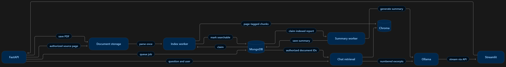
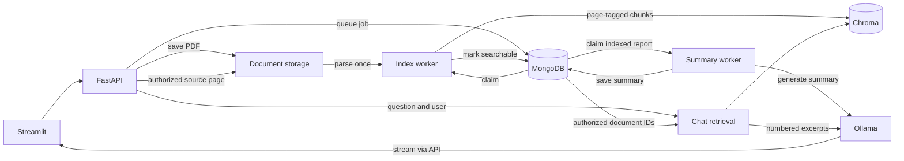

# MediGuide

MediGuide turns an uploaded report into searchable, page-cited answers. A patient can ask about a measurement as soon as indexing finishes, while a separate worker prepares the summary.

## Try it locally

From the repository root, create a Python 3.12 virtual environment with `python -m venv .venv`. Activate it with `.\.venv\Scripts\Activate.ps1` in PowerShell or `source .venv/bin/activate` in Bash.

```sh
python -m pip install -r demo/requirements.txt
python -m demo
```

Open [the local walkthrough](http://127.0.0.1:8501). Use `python -m demo --port 8502` if the default port is occupied. Ctrl+C ends the session.

The walkthrough runs the Streamlit UI, FastAPI, PDF parser, background workers, Chroma search and access checks locally. Its database is temporary. A scripted extractor answers questions about the two fictional samples using the retrieved passages. Test embeddings replace the downloaded embedding model. The walkthrough needs no account with an AI provider.

For a terminal replay, run `python -m demo --check`. It signs up a temporary patient, uploads the bundled PDF, reads a streamed answer, follows its citation, and verifies the value against the original page.

## Architecture

The diagram shows the default Ollama workflow. Start at **FastAPI** on the left for uploads and at **Chat retrieval** near the lower right for questions.

[](docs/images/mediguide-architecture.png)

Select the diagram to view it at full size.

1. **Upload and index.** FastAPI saves the PDF and queues a job in MongoDB. The index worker splits the text into passages, keeps each passage's page number, and indexes them in Chroma. The report is now ready for questions.
2. **Summarize in the background.** A separate worker sends the extracted text to Ollama and saves the summary in MongoDB. A patient can use chat while this worker runs. If a worker stops mid-job, another can reclaim the job when its lease expires.
3. **Ask and verify.** MongoDB identifies which documents the patient can access. Chat searches those documents in Chroma and passes numbered excerpts to Ollama. FastAPI streams the answer to Streamlit. Selecting a citation opens the original page so the patient can check the wording.

Patients can also select Groq in Chat to send their question and authorized excerpts to that service. The admin comparison uses predefined fictional cases with Groq, Gemini and OpenRouter. [Provider configuration and comparison](server/README.md)

<details>
<summary>View the Mermaid version</summary>



</details>

## Measured performance

A local run on **21 November 2026** used Windows 11, Python 3.12.10 and an Intel Core i5-13450HX. One client submitted ten distinct five-page text PDFs sequentially. Timings start immediately before the in-process HTTP upload. Searchable time includes polling for the indexed state.

| Measurement | Observed |
| --- | ---: |
| Upload acknowledgement across ten reports | 4–9 ms |
| First report searchable | 229 ms |
| Next nine reports searchable | 28–136 ms (median 33 ms) |

Before adding worker notifications, the same workload took 715 ms for the first report and a median of 533 ms for the next nine. Workers now wake after a job is recorded and still poll for interrupted jobs.

Reproduce with `python -m server.benchmark_reports`. The benchmark uses real PDF extraction, chunking and Chroma writes, an in-memory MongoDB substitute, deterministic test embeddings and simulated model responses. It holds the first summary open while checking chat. These measurements describe local ingestion. Live model latency, answer quality and provider costs require separate runs.

## Regression checks

```sh
python -m server.check_upgrade
```

The suite exercises signup restrictions, patient isolation, source-page authorization, streaming and interruption handling, provider fallback, the walkthrough fixture, deduplication and worker recovery. GitHub Actions runs the same command on pushes and pull requests. [CI workflow](.github/workflows/regression.yml)

## Run with MongoDB and Ollama

Install the dependencies in [server/requirements.txt](server/requirements.txt) and [client/requirements.txt](client/requirements.txt). Start MongoDB and Ollama with your chosen model installed. Configure `server/.env` with `MONGODB_URI`, `MONGODB_DB_NAME`, `EMBEDDING_MODEL`, `CHROMA_PERSIST_DIR`, `OLLAMA_BASE_URL` and `OLLAMA_MODEL`. Set `BASE_URL=http://127.0.0.1:8001` in the root `.env`.

Start the API with `python -m uvicorn server.main:app --port 8001`. In a second terminal, run `python -m streamlit run client/main.py`. This path uses persistent storage, Hugging Face embeddings and Ollama for patient chat and summaries. [Document processing and retries](server/docs/README.md)


To verify Groq with the bundled synthetic PDF, configure GROQ_MODEL and GROQ_API_KEY
in server/.env, then run `python -m demo --check-groq`. This opt-in check uses
a real network request, prints first-text and completion times, and checks the
model citation against page 2. Offline regression checks use simulated responses.
